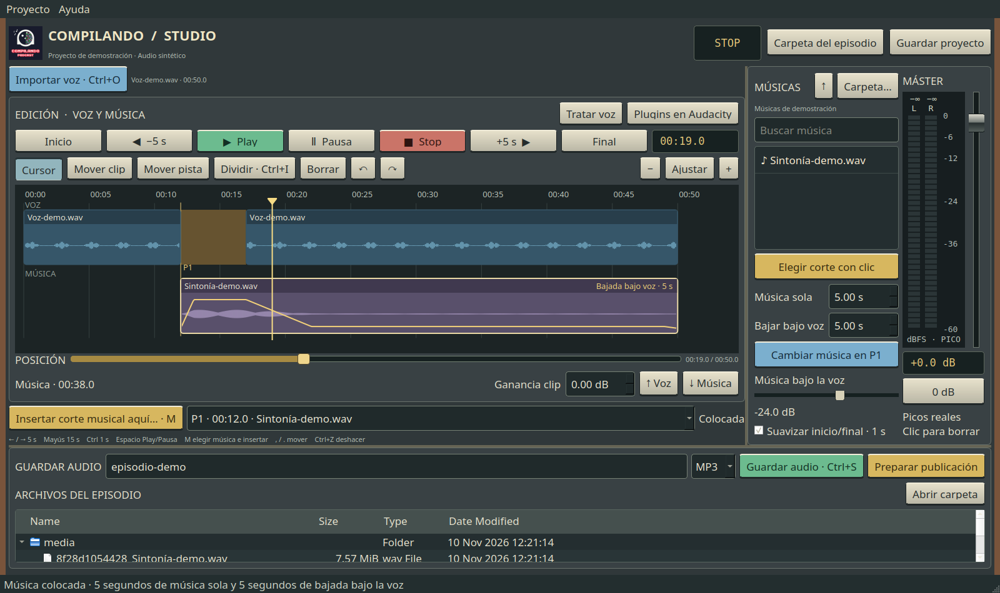

# Compilando Studio · Radio Edition 0.1.2

Editor de podcast para GNU/Linux. Edición no destructiva de voz y músicas,
con aspecto inspirado en mesas de radio clásicas, medidores digitales reales
y exportación local. Primera versión pública en desarrollo.



Importa la voz grabada en tu teleprompter, elige dónde insertar música y deja
que la aplicación abra el hueco y baje la sintonía bajo la voz. Todo funciona
localmente, sin cuenta ni servicios de pago.

- Importación WAV/FLAC/MP3 y edición por clips.
- Cortes musicales con selector de archivos y fundido automático configurable.
- Atajos de teclado, cursor arrastrable, vúmetro digital y control máster.
- Guardado de proyectos y exportación MP3, WAV y FLAC.
- Preparación de archivos para publicar el episodio.

**Descargas y novedades:** consulta la sección Releases del repositorio.

## Instalación en Linux Mint / Ubuntu

1. Descomprime el ZIP.
2. Abre **compilando-studio_0.1.2_all.deb** con el instalador de paquetes.
3. Instala el paquete y sus dependencias. Aparecerá **Compilando Studio** en
   el menú de aplicaciones, dentro de Sonido y vídeo.

Alternativa desde una terminal abierta en la carpeta descomprimida:

```sh
sudo apt install ./compilando-studio_0.1.2_all.deb
```

Para ejecutar el código sin instalar el paquete, con las dependencias ya
disponibles, ejecuta `sh run.sh` desde la raíz del repositorio, o
`sh codigo/run.sh` desde el ZIP de instalación.
Requiere Python 3.10+, NumPy, PyQt5, Qt Multimedia y FFmpeg. Audacity es opcional.
El paquete está pensado para Linux Mint 22 / Ubuntu 24.04 y sistemas compatibles.

## Actualizar desde 0.1.0 o 0.1.1

Guarda el proyecto y cierra Compilando Studio. Instala el nuevo `.deb` encima
del anterior y vuelve a abrir tu proyecto. No hace falta desinstalar. Los
proyectos de 0.1.1 conservan sus cortes y tiempos guardados. Los de 0.1.0 usan
una bajada de 5 segundos, que puedes cambiar y guardar. Los fundidos de un
segundo se conservan para suavizar el inicio y final de cada música.

## Primer episodio

1. Pulsa **Carpeta del episodio** y elige la carpeta de trabajo. Puedes crearla
   desde el diálogo. Así tendrás guion, imágenes y audios a mano, en el panel inferior.
2. Graba en el teleprompter y guarda la toma como WAV o FLAC.
3. Pulsa **Importar voz** o arrastra el archivo sobre la pista de voz.
   Se copia a `media/`; el archivo original no se modifica.
4. Sitúa el cursor con la barra **POSICIÓN**, la regla superior o la línea dorada,
   que puedes pinchar y arrastrar.
5. Pulsa **Insertar corte musical aquí… · M**. Se abre el navegador de archivos
   para elegir una canción. Después de cargarla, se divide la voz, se abre el hueco
   de **Música sola** (5 segundos por defecto) y se coloca la música elegida.
   Si cancelas o el archivo no se puede leer, el montaje queda intacto.
   Un solo **Ctrl+Z** deshace tanto el hueco nuevo como la música.
   La carpeta elegida aparece en el panel derecho y se recuerda para la próxima sesión.
6. Pulsa Play. La música suena a nivel completo en el hueco y baja al entrar
   la voz mediante un fundido de **5 segundos**, configurable en **Bajar bajo voz**.
   Son dos tiempos independientes: 5 segundos de música sola y después 5 segundos
   de bajada mientras entra la voz. **Música bajo la voz** ajusta el volumen final.
   La línea dorada sobre la música muestra la curva que realmente se aplica. El máster
   modifica tanto la reproducción como la exportación. El medidor muestra
   picos de muestra en dBFS, conserva máximos y avisa de saturación.
7. Guarda el proyecto para continuar otro día y exporta la mezcla final.
   MP3 es el formato predeterminado (192 kb/s); también hay WAV de 24 bits y FLAC.

Cada archivo musical se usa hasta agotar su duración o llegar al siguiente
punto musical. No se repite automáticamente. Los fundidos y la atenuación se
calculan a partir de la posición de los clips de voz, no mediante reconocimiento
de palabras. La mezcla trabaja a 44,1 kHz estéreo; los originales conservan su formato.

## Completar un corte vacío de versiones anteriores

Abre el proyecto guardado, sitúa el cursor en cualquier lugar del hueco P1 y
pulsa **Insertar corte musical aquí… · M**. Elige la canción: se completa P1 sin
abrir otro hueco ni desplazar de nuevo la voz. También puedes seleccionar P1 en
el desplegable y pulsar **Elegir música en P1…** en el panel derecho.

Si ya tienes una canción seleccionada en el panel, **Colocar música en P1**
la asigna directamente; también puedes arrastrarla hasta el corte. El botón
**Insertar corte musical aquí…** siempre abre el selector, con la canción
seleccionada como propuesta. Si el corte ya tiene música, la nueva la sustituye.
La copia de la canción queda en `media/`, visible al desplegar esa carpeta
en **Archivos del episodio**. El original permanece intacto.

## Editar

- **POSICIÓN** permite pinchar en cualquier punto y arrastrar hacia delante o atrás,
  incluso sin ampliar la onda. Si estabas reproduciendo, continúa al soltar.
- La regla superior y la línea dorada del cursor también se arrastran.
- La barra **Vista ampliada** sólo aparece con zoom y desplaza la vista, no el audio.
- **Cursor** mueve el cabezal sin crear puntos musicales.
- **Dividir** corta el clip seleccionado en el cursor, sin abrir un hueco.
- Arrastra la cabecera de un clip, o usa **Mover clip**, para desplazarlo.
- **Mover pista** desplaza todos sus clips. Los puntos y músicas asociados a
  clips de voz acompañan su desplazamiento.
- Se pueden superponer clips; si coinciden, sus señales se suman. Vigila el máster.
- **Borrar** elimina el clip del montaje y deja su hueco. No borra archivos.
  Si quitas un clip de voz que sostiene un punto musical, se elimina también
  ese punto y su música. Puedes deshacerlo.
- Los botones +, − y Ajustar controlan el zoom. Usa la barra horizontal para
  recorrer una grabación larga.
- **Ganancia clip** modifica sólo el clip seleccionado.
- **Tratar voz** crea un WAV corregido con filtro de graves, compresión y/o
  normalización. Conserva el montaje y permite deshacer.

## Teclado

| Acción | Atajo |
|---|---|
| Importar voz | Ctrl+O |
| Play / pausa | Espacio |
| Stop | S |
| Retroceder / avanzar 5 s | ← / → |
| Retroceder / avanzar 15 s | Mayús+← / → |
| Ajustar 1 s | Ctrl+← / → |
| Seleccionar voz / música | ↑ / ↓ |
| Inicio / final | Inicio / Fin |
| Elegir música e insertar/completar corte en el cursor | M |
| Colocar música en el punto elegido | Ctrl+Intro |
| Dividir clip | Ctrl+I |
| Borrar clip | Supr |
| Mover clip o pista 0,5 s | , / . |
| Mover clip o pista 5 s | Mayús+, / . |
| Deshacer / rehacer | Ctrl+Z / Ctrl+Mayús+Z |
| Volver al cursor | Esc |
| Exportar audio | Ctrl+S |
| Guardar proyecto | Ctrl+Mayús+S |
| Abrir proyecto | Ctrl+Mayús+O |

Los campos de texto conservan sus teclas de edición.

## Proyectos y recuperación

El proyecto se guarda como `episodio.compilando.json`, con referencias relativas
a la carpeta `media/`. Conserva la carpeta entera cuando hagas copias o cambies
de ordenador. Las portadas elegidas también se copian a `media/`.

Mientras hay cambios, se actualiza cada 20 segundos
`recuperacion.compilando.json`. Puedes abrir ese archivo desde Proyecto si
necesitas recuperar una sesión. La aplicación pregunta antes de cerrar con
cambios sin guardar. No sobrescribe las tomas de origen al exportar.

## Teleprompter

La importación de WAV/FLAC ya funciona. No se ha modificado el teleprompter.
Compilando Studio acepta un archivo como argumento, y aparece entre las
aplicaciones disponibles para abrir audio después de instalar el paquete:

```sh
compilando-studio /ruta/voz.flac
compilando-studio --episode /ruta/podcast73 --voice /ruta/voz.wav
```

Esto permite añadir después un botón «Abrir en Compilando Studio» al teleprompter.
Si existe un proyecto en la carpeta indicada, se abre antes de preguntar si
quieres sustituir su voz.

## Audacity y plugins

**Plugins en Audacity** exporta una copia WAV de la voz montada y abre Audacity
en una ventana independiente. Los plugins funcionan dentro de Audacity.
Exporta el resultado allí y vuelve a importarlo cuando quieras usar esa toma.
Esta reimportación empieza un montaje nuevo; guarda el anterior antes.
Todavía no hay sincronización automática de cortes entre las dos aplicaciones.

## Preparar publicación

Introduce título, autor, resumen y portada. Se crea una carpeta nueva
`Publicacion-fecha-hora` con:

- `episodio.mp3`, con título, autor y portada incorporados cuando se selecciona.
- `resumen.txt`, para copiar a la web, iVoox o Spotify.
- `entrada-web.html`, un texto HTML básico con reproductor.
- La portada y `datos-episodio.json`.

No genera automáticamente el texto ni la imagen. No envía ni publica archivos,
no guarda contraseñas y no modifica feeds. La subida a cada plataforma sigue
siendo manual en esta versión.

## Validación y alcance

Se han comprobado con archivos de prueba el motor de mezcla, los cortes sin
alterar muestras, los huecos musicales, el movimiento de clips, la atenuación,
el máster, deshacer, la copia y reapertura de proyectos, el paquete de publicación,
la importación real desde la interfaz y la exportación/relectura WAV, FLAC y MP3.
También se ha revisado la interfaz mediante captura local.

La salida física de sonido no se ha podido escuchar en el entorno de desarrollo.
No se ha probado todavía con episodios completos de larga duración ni en todas
las distribuciones. Las incidencias y sugerencias se pueden comunicar en Issues,
indicando versión, distribución y pasos para reproducir el problema.
El audio decodificado usa archivos temporales de sesión y necesita espacio libre
(aproximadamente 1,27 GB por hora y archivo a 44,1 kHz estéreo flotante).

## Código y licencia

El código está en `compilando/` (o `codigo/compilando/` dentro del ZIP).
GPL-3.0-or-later; texto de licencia en LICENSE.
Las dependencias se instalan desde el sistema y conservan sus propias licencias.
El logotipo de Compilando se incluye para identificar este proyecto.

Para repetir las pruebas desde la raíz del código:

```sh
python3 -m unittest discover -s tests -v
QT_QPA_PLATFORM=offscreen PYTHONPATH=. python3 tests/gui_smoke.py
QT_QPA_PLATFORM=offscreen PYTHONPATH=. python3 tests/gui_seek_and_cues.py
QT_QPA_PLATFORM=offscreen PYTHONPATH=. python3 tests/gui_music_picker.py
```

Para construir el instalador, el ZIP, el archivo de fuentes y las sumas SHA-256:

```sh
python3 build.py
cd dist
sha256sum -c SHA256SUMS
```

La captura de pantalla utiliza audio sintético de demostración. El repositorio
no incluye grabaciones de episodios ni canciones de terceros.
